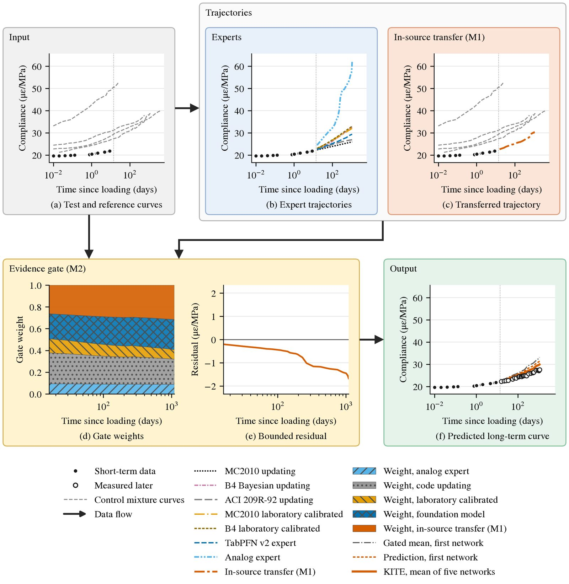

<div align="center">

# KITE

---

### Knowledge guided neural network with design code models and laboratory reference transfer for predicting long term creep and shrinkage of concrete from short term tests

[](https://twakjira.github.io/KITE/)
[](https://twakjira.github.io/KITE/)
[](#data)

[Tadesse G. Wakjira](https://www.ai4riselab.com), [Hana L. Goshu](https://hanagoshu.com)

*Under Review*

</div>

## Overview

Qualifying a new low carbon concrete for long term deformation takes tests of months to years, and design
code updating from a few weeks of data leaves large errors. KITE, a knowledge guided neural network, predicts
the complete shrinkage or creep curve from the first 7 to 28 days of a test. An in source transfer module attends over the curves of a
control mixture of the same program, and an interpretable evidence gate weights the transferred trajectory
against design code experts, an analog expert and a cross fitted tabular foundation model at every horizon.

<div align="center">

</div>

Over 196 laboratory units of 4,026 tests from 239 laboratories, KITE reaches a relative RMSE of 0.147 and lowers
the error by 12.2% relative to the strongest of 26 baselines, with every bootstrap interval above zero and every
Holm adjusted p value below 0.001. Without a laboratory reference, KITE lowers the error by 9.5% relative to
the strongest of 16 baselines.

Figures, tables and an interactive viewer of the predictions are on the [project page](https://twakjira.github.io/KITE/).

## Status

Analysis code and trained models will be released in this repository on acceptance of the paper.

## Architectural contributions

| Module | Content |
| --- | --- |
| M1 | In source transfer. Attention over the curves of the control mixture of the same program, with a learned bias for the composition difference |
| M2 | Evidence gate. Weights for every expert at every horizon, with a residual bounded by the disagreement of the experts |
| Experts | ACI 209R-92, fib Model Code 2010 and Model B4 updating; MC2010 and B4 calibrated on the control mixture; an analog expert over curves of other laboratories; TabPFN v2 cross fitted by research team |

## Results

Relative RMSE over 196 query units, averaged over three partitions with folds grouped by research team. KITE is
significantly more accurate than every baseline, with Holm adjusted p values below 0.001.

| Model | Relative RMSE | Error reduction by KITE (%) |
| --- | --- | --- |
| KITE | 0.147 |  |
| TabPFN v2 with reference | 0.168 | 12.2 |
| Random forest with reference | 0.178 | 17.1 |
| Evidence average | 0.178 | 17.2 |
| Laboratory analog | 0.185 | 20.5 |
| Neural process with reference | 0.189 | 21.9 |
| MC2010 updating | 0.250 | 41.0 |
| B4 Bayesian updating | 0.281 | 47.6 |

Increase of the KITE error in percent when a component is removed or replaced (three partitions unless noted).

| Variant | Error increase (%) |
| --- | --- |
| Trained without the reference (first partition) | 13.1 |
| Equal expert weights instead of the gate (M2) | 8.9 |
| Without in source transfer (M1) | 6.7 |
| Static gate weights (M2) | 5.6 |
| Without the foundation model expert | 5.0 |
| Without the bounded residual (M2) | 3.0 |
| Without the analog expert (first partition) | 0.8 |

## Data

| Source | Use |
| --- | --- |
| [NU/RILEM creep and shrinkage database, revamped version](https://doi.org/10.5281/zenodo.8150177) (CC BY 4.0) | 4,026 drying shrinkage, autogenous shrinkage and creep tests from 239 laboratories |

## Citation

```bibtex
@article{wakjira2026kite,
  title   = {Knowledge guided neural network with design code models and laboratory reference transfer
             for predicting long term creep and shrinkage of concrete from short term tests},
  author  = {Wakjira, Tadesse G. and Goshu, Hana L.},
  journal = {Under Review},
  year    = {2026}
}
```

## Authors

[Tadesse G. Wakjira](https://www.ai4riselab.com), [Hana L. Goshu](https://hanagoshu.com)

## Development

Developed by the [AI4RISE Lab](https://www.ai4riselab.com).
